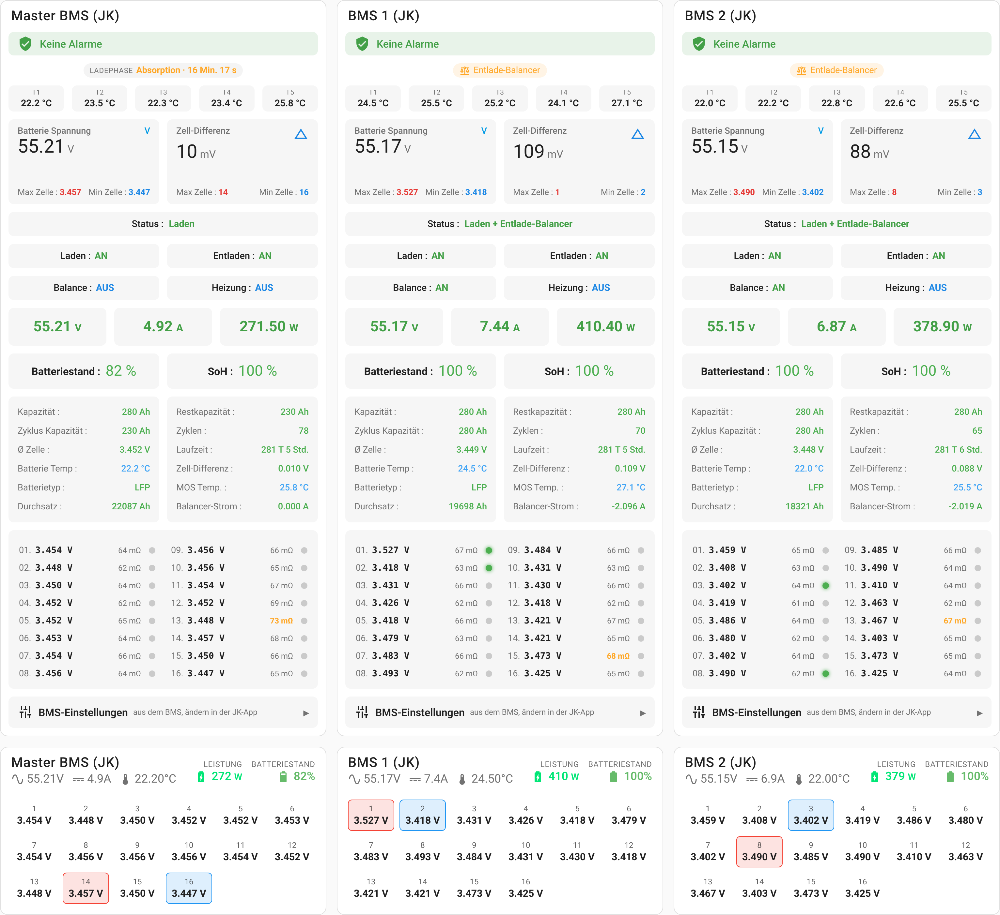
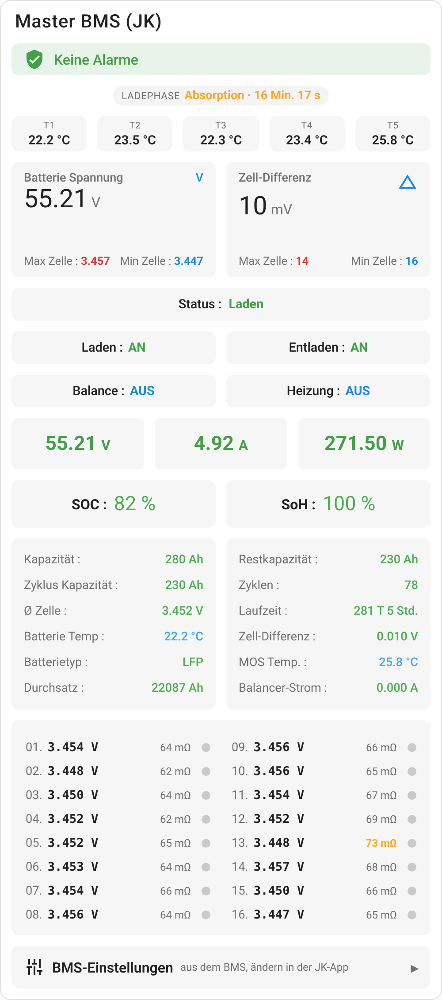
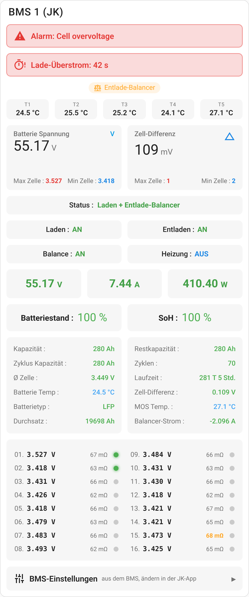
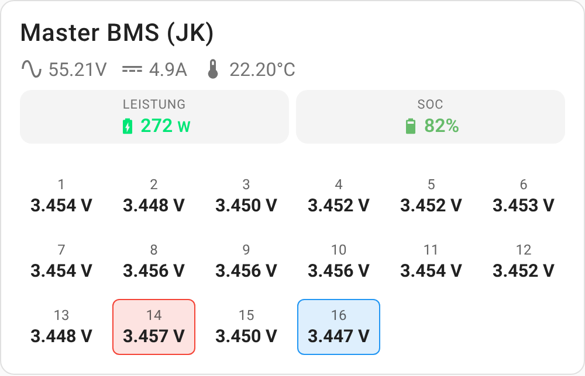

[](https://hacs.xyz/docs/faq/custom_repositories/)
[](https://github.com/Xander2980/bms-battery-cells-card-jkbms/actions?query=workflow%3Avalidate)
[](https://github.com/Xander2980/bms-battery-cells-card-jkbms/releases/)

[](https://github.com/Xander2980/bms-battery-cells-card-jkbms/blob/main/docs/README-de.md)
[](https://github.com/Xander2980/bms-battery-cells-card-jkbms/stargazers)

# BMS Battery Cells Card – JK-BMS-Fork

Fork der [BMS Battery Cells Card](https://github.com/jayjojayson/bms-battery-cells-card) von jayjojayson (Stand v_2.0), erweitert für das **JK-BMS** mit dem Add-on [jkbms-rs485-addon](https://github.com/jean-luc1203/jkbms-rs485-addon).

📖 **[Anleitung mit Bildern: Einrichten & Werte einstellen](docs/EINRICHTEN.md)**

**Kartentyp:** `custom:bms-battery-cells-card-jkbms` – eigener Name und eigene Datei (`bms-battery-cells-card-jkbms.js`), die Original-Karte kann parallel installiert bleiben.

## Zusätzlich gegenüber dem Original

| Funktion | Beschreibung |
|---|---|
| **Automatik per Präfix** | `jk_prefix: bms_master` (bzw. `bms_1`, `bms_2` …) setzt Zellen (Anzahl wird erkannt), Zellwiderstände und alle Sensoren automatisch. Selbst eingetragene Werte haben Vorrang. |
| **Alarm-Banner** | Grün „Keine Alarme“ bzw. rot pulsierend mit Alarmtext (`alarm_entity`, `alarm_list_entity`). In der Standardansicht erscheint bei Alarm ein rotes Symbol im Kopf. |
| **Ladephase** | Bulk / Absorption / Float mit Dauer (`charge_status_entity`, `charge_status_time_entity`). |
| **Temperaturfühler 1–4** | `temp_entity`, `temp_2_entity`, `temp_3_entity`, `temp_4_entity` als eigene Zeile. |
| **Zellwiderstände** | Anzeige in mΩ, höchster Widerstand orange markiert. |
| **Durchsatz & Laufzeit** | `throughput_entity` (Ah gesamt), `runtime_entity`. |
| **Sichere Status-Anzeige** | Mit Präfix zeigen Laden/Entladen/Balance die `binary_sensor`-Zustände – ein Klick schaltet das BMS **nicht** ab. Wer schalten will, trägt `stat_charge_entity` usw. selbst ein. |

Neue Optionen: `jk_prefix`, `show_jk_info` (Standard `true`), `alarm_entity`, `alarm_list_entity`, `charge_status_entity`, `charge_status_time_entity`, `temp_2_entity`, `temp_3_entity`, `temp_4_entity`, `throughput_entity`, `runtime_entity`.

### Bilder

Ansicht mit drei parallelen JK-BMS (Master, BMS 1, BMS 2): je Spalte oben die Detailansicht, darunter die kompakte Zelltabelle. Werte vom 18.11.2026 (Ladung läuft, Ladephase Bulk). Darunter Detailansicht einzeln, ein Alarm-Beispiel und die Zelltabelle.



 


### Beispiel

```yaml
type: custom:bms-battery-cells-card-jkbms
title: Master BMS
jk_prefix: bms_master
show_detailed_view: true
show_status: true
balance_led: true
```

### Installation (HACS, benutzerdefiniertes Repository)

Direkt in Home Assistant öffnen:

[](https://my.home-assistant.io/redirect/hacs_repository/?owner=Xander2980&repository=bms-battery-cells-card-jkbms&category=plugin)

Oder von Hand:

1. HACS → ⋮ → Benutzerdefinierte Repositories → `https://github.com/Xander2980/bms-battery-cells-card-jkbms`, Typ **Dashboard** → Hinzufügen.
2. „BMS Battery Cells Card (JK-BMS)“ herunterladen, Browser neu laden.
3. Karte `custom:bms-battery-cells-card-jkbms` verwenden.

> Hinweis: Das Repository gehört in **HACS**, nicht unter Einstellungen → Apps → Repositories – dort erscheint sonst „is not a valid app repository“.

Erwartete Entitäten (Präfix `p`): `sensor.p_bms_cell_N_volt`, `sensor.p_bms_cell_N_ohm`, `sensor.p_bms_soc_pourcentage`, `sensor.p_bms_sonde_1..4_temp`, `sensor.p_bms_charge_status_text`, `binary_sensor.p_p_alarm_active`, `sensor.p_p_alarm_list` usw.

---

# BMS Battery Cells Card

Visualization of individual cell voltages of your battery storage system (BMS)

The 🔋 BMS Battery Cells Card is a custom Lovelace card for visualizing the individual cell voltages of your battery storage system (BMS). It provides a clear overview of the status of all cells, including min/max values and balancing status.

The card can be fully configured via the card editor user interface.
You need the corresponding entities from your BMS (e.g. Victron, JK-BMS, Daly, Seplos, JBD) that provide the cell voltages in Home Assistant.
Regular batteries (AGM and similar with 12, 24v or 48v) also work, as long as you have suitable entities available in Home Assistant.

Supported card languages are English, German, French and Greek. If you need other languages as well, tell me.

If you like this custom card, I would really appreciate a star rating ⭐. Thanks 🤗

## Features

### 🔋 **Visualizations & Layouts**

- **Individual Cell Voltage:** Bar charts with dynamic color thresholds (Min/Max/Avg)
- **Multiple Layout Modes:**
  - 📏 **Standard View:** Classic bar chart visualization
  - 📋 **Table View:** Compact grid showing only numbers (no bars)
  - 📃 **List View:** Horizontal layout for a list-like appearance
  - 🎛️ **Detailed View:** A full BMS dashboard view
- **Compact Mode:** Option to hide bars and show only header stats
- **Animations:** Charging (power in) and Discharging (power out) animations on cell bars

### 📈 **Detailed View (optional)**

- **Integrated Charts:** Live history graphs for **Total Voltage** and **Cell Delta** (using Chart.js)
- **Extended BMS Metrics:** Display of **SoH**, **Cycles**, **Capacity** (Ah), and **MOS Temperature**
- **Remaining Capacity:** Auto-calculation based on Amp-hours and SoC
- **Cell List:** detailed table of all cell voltages including individual balancing status
- **Hybrid View:** Option to show the standard cell bars _inside_ the detailed view

### ⚡ **BMS Control & Interactive Elements**

- **Interactive Status Switches:** Toggle **Charge**, **Discharge**, and **Balance** directly from the card (supports Switches, Input Booleans, and Input Selects)
- **Custom State Logic:** Define custom values for "On" and "Off" states (e.g., `True`/`False`, `On`/`Off`)
- **Balance Switch:** for BMS like seplos, tdt BMS, daily or jbd
- **Balance Sensor:** Define a Balance Sensor for each cell (like JK-BMS)
- **Click Actions:** Click on sensors, charts, or cells to open the Home Assistant "More Info" dialog

### 📉 **Statistics & Monitoring**

- **Real-time Stats:** Total Voltage, Current, Power (Watt), and Temperature
- **Smart Delta Calculation:** Automatically calculates the difference between Min and Max cells (or uses an external sensor)
- **Min/Max Indicators:** Visual highlighting of the highest and lowest voltage cells
- **Average Voltage:** Option to display the calculated average cell voltage

### ⚙️ **Configuration & Customization**

- **UI Editor:** Fully configurable via the Home Assistant UI editor (no YAML required)
- **Thresholds:** Adjustable Minimum and Maximum voltage for color scaling
- **Visual Tweaks:** Options for thicker borders, hiding header values, and a lot more

---

## Installation

### HACS (Recommended)

- Add the GitHub repository via the link in Home Assistant.

  [](https://my.home-assistant.io/redirect/hacs_repository/?owner=Xander2980&repository=bms-battery-cells-card-jkbms&category=plugin)

- The "BMS Battery Cells Card (JK-BMS)" should now be available in HACS. Click "INSTALL".
- The resource will be automatically added to your Lovelace configuration.

<details>
  <summary> <b>Manual Installation via Hacs</b></summary>

### Manual Installation via Hacs

Open HACS in Home Assistant..

- Click the three dots in the upper right corner.
- Select "Custom repositories".
- Add `https://github.com/Xander2980/bms-battery-cells-card-jkbms` and select "Dashboard" as the type.
- Click "ADD".
- The "BMS Battery Cells Card (JK-BMS)" should now be available in HACS. Click "INSTALL".
- The resource will be automatically added to your Lovelace configuration.
</details>

<details>
  <summary> <b>Manual Installation in HA</b></summary>  
 
### Manual  Installation in HA
1.  **Download files:**
    * Download the dist/bms-battery-cells-card-jkbms.js from this repository.

2.  **import files to Home Assistant:**
    - Create a new folder named `bms-battery-cells-card-jkbms` in the `www/community`-directory of your Home Assistant configuration. (The www directory is located in the same folder as your configuration.yaml).
    - Copy all downloaded files into this new folder. Your folder structure should look like this:
      ```
      /config/www/community/bms-battery-cells-card-jkbms/bms-battery-cells-card-jkbms.js
      ```

3.  **Add the resource to Home Assistant::**
_ In Home Assistant, go to Settings > Dashboards.
_ Click the three-dot menu in the top right corner and select Resources.
_ Click + Add resource.
_ Enter /local/community/bms-battery-cells-card-jkbms/bms-battery-cells-card-jkbms.js as the URL.
_ Select JavaScript module as the resource type.
_ Click Create.
</details>

---

## Configuration

After installation, you can add the card to your dashboard:

1.  **Enable edit mode:**
    - Open the dashboard where you want to add the card and click **Edit.**.

2.  **Add card:**
    - Click + Add card and search for **"BMS Battery Cells Card"**.

3.  **Configure options:**
    - A configuration dialog will open where all settings can be conveniently adjusted.
    - **BMS Entity:** The main entity or list of sensors.
    - **Voltage Range:** Define the minimum and maximum voltage for the graphical display.
    - **Details:** Display additional values ​​such as battery power, temperature, delta, or average voltage.

---

## YAML-Mode (optinal)

Although UI configuration is recommended, the map can also be configured manually via the YAML editor:

### Options

| name                      | type      | required | description                                                        | default             |
| ------------------------- | --------- | -------- | ------------------------------------------------------------------ | ------------------- |
| `type`                    | `string`  | Yes      | Card type definition. Must be `custom:bms-battery-cells-card-jkbms`.     |                     |
| `title`                   | `string`  | No       | Title displayed at the top of the card. Without a title, a default in the Home Assistant language is used. | e.g. `"Battery Cells"` |
| `cells`                   | `list`    | Yes      | List of cell definitions (entity + name).                          | 4 example cells     |
| `cells[].entity`          | `string`  | Yes      | Sensor entity representing the cell voltage.                       |                     |
| `cells[].name`            | `string`  | No       | Display name of the cell.                                          | Cell index          |
| `show_legend`             | `boolean` | No       | Show voltage scale (Y-axis) on the left side.                      | `true`              |
| `container_padding`       | `number`  | No       | Inner padding of the card container (px).                          | `16`                |
| `card_height`             | `number`  | No       | Fixed height of the card in pixels.                                | `380`               |
| `cell_gap`                | `number`  | No       | Gap between individual cells (px).                                 | `4`                 |
| `show_values`             | `boolean` | No       | Display voltage values inside each cell.                           | `true`              |
| `show_values_on_top`      | `boolean` | No       | Display statistic values above icons instead of inline.            | `false`             |
| `enable_animations`       | `boolean` | No       | Enable charging/discharging animations.                            | `true`              |
| `min_voltage`             | `number`  | No       | Minimum cell voltage for scaling.                                  | `2.60`              |
| `max_voltage`             | `number`  | No       | Maximum cell voltage for scaling.                                  | `3.65`              |
| `show_min_max`            | `boolean` | No       | Highlight the cells with minimum and maximum voltage.              | `true`              |
| `show_average`            | `boolean` | No       | Display average cell voltage in statistics.                        | `false`             |
| `cell_background_color`   | `string`  | No       | Track background color. `gradient` or any CSS color string.        | `gradient`          |
| `cell_background_opacity` | `number`  | No       | Background opacity for cell tracks (0.0-1.0).                      | `0.25`              |
| `cell_bar_color`          | `string`  | No       | Bar color mode: `range`, `delta`, or hex color (custom).           | `range`             |
| `cell_bar_opacity`        | `number`  | No       | Cell bar opacity (0.0-1.0).                                        | `0.6`               |
| `cell_bar_top_color`      | `string`  | No       | Bar top color for `delta` mode (hex).                              | `#173117`           |
| `cell_bar_bottom_color`   | `string`  | No       | Bar bottom color for `delta` mode (hex).                           | `#3c2222`           |
| `soc_entity`              | `string`  | No       | State of Charge (SoC) sensor entity.                               |                     |
| `watt_entity`             | `string`  | No       | Power sensor entity (positive = charging, negative = discharging). |                     |
| `cell_diff_sensor`        | `string`  | No       | Cell voltage delta sensor (`mV` or `V`, detected via the unit).    |                     |
| `temp_entity`             | `string`  | No       | Battery temperature sensor entity (`°C`, `°F` or `K`, as reported by Home Assistant). |                     |
| `temp_mos_entity`         | `string`  | No       | MOSFET temperature sensor (detailed view, unit as reported by Home Assistant). |                     |
| `cells[].resistance_entity` | `string` | No      | Resistance sensor per cell, shown in the cell list (detailed view). |                    |
| `show_title_in_detail`    | `boolean` | No       | Show the card `title` in the detailed view.                        | `true`              |
| `show_status`             | `boolean` | No       | Detailed view: overall status (Charging / Discharging / Balancing / Idle), derived from power/current and balancing state. | `false` |
| `balance_led`             | `boolean` | No       | Detailed view: show cell balancing as an LED instead of "bal. on / bal. off". | `false`  |
| `stat_heater_entity`      | `string`  | No       | Detailed view: heater switch / input_boolean / select, shown next to Charge, Discharge and Balance. |  |
| `stat_heater_on` / `stat_heater_off` | `string` | No | Custom ON/OFF values for the heater entity (e.g. for selects).  |                     |

> **Units:** Temperatures are shown in the unit of the entity (`°C`/`°F`/`K`). Cell voltages and the cell delta are normalized using the `unit_of_measurement` of the sensor (`V`/`mV`); sensors without a unit fall back to automatic detection.

### Example configuration

simple example:

```yaml
type: custom:bms-battery-cells-card-jkbms
title: Battery Cells
cells:
  - entity: sensor.cell_1
    name: "1"
  - entity: sensor.cell_2
    name: "2"
  - entity: sensor.cell_3
    name: "3"
  - entity: sensor.cell_4
    name: "4"
```

advanced example:

```yaml
type: custom:bms-battery-cells-card-jkbms
cells:
  - name: "1"
    entity: sensor.vrm_maximum_cell_voltage_batt_1
  - name: "2"
    entity: sensor.vrm_minimum_cell_voltage_batt_1
  - name: "3"
    entity: sensor.vrm_maximum_cell_voltage_batt_2
  - name: "4"
    entity: sensor.vrm_minimum_cell_voltage_batt_2
soc_entity: sensor.victron_system_battery_soc
watt_entity: sensor.vrm_battery_power_batt_1024
cell_background_color: "gradient"
cell_background_opacity: 0.28
cell_bar_color: "delta"
cell_bar_opacity: 0.75
cell_bar_top_color: "#13a826"
cell_bar_bottom_color: "#941414"
cell_diff_sensor: sensor.vrm_minimum_cell_voltage_batt_1
temp_entity: sensor.vrm_battery_temperature_batt_1
show_values_on_top: false
enable_animations: true
title: Battery Cells
thicker_borders: true
min_voltage: 2.6
max_voltage: 3.65
show_average: false
```

---

### CSS Elements

| Selector            | Description                                   |
| :------------------ | :-------------------------------------------- |
| `.header`           | Card header area.                             |
| `.card-header`      | Header containing the title and statistics.   |
| `.title`            | Card title.                                   |
| `.stats`            | Container for statistic values.               |
| `.stat-item`        | Individual statistic block.                   |
| `.stat-label`       | Label of a statistic value.                   |
| `.stat-value-row`   | Row containing icon and value.                |
| `.vertical-layout`  | Vertical layout for icon/value.               |
| `.main-container`   | Main container for the cells.                 |
| `.cells-container`  | Container holding all cell elements.          |
| `.legend-col`       | Voltage scale (Y-axis).                       |
| `.cell-wrapper`     | Wrapper for a single cell.                    |
| `.cell-item`        | Individual battery cell.                      |
| `.min-cell`         | Highlights the cell with the lowest voltage.  |
| `.max-cell`         | Highlights the cell with the highest voltage. |
| `.custom-tooltip`   | Tooltip shown on click / hover.               |
| `.cell-track-bg`    | Cell background with gradient.                |
| `.cell-bar`         | Voltage bar of the cell.                      |
| `.is-charging`      | Charging animation active.                    |
| `.is-discharging`   | Discharging animation active.                 |
| `.charging-overlay` | Animated overlay layer.                       |
| `.cell-info-layer`  | Overlay layer for labels.                     |
| `.cell-name-wrap`   | Container for the cell name.                  |
| `.cell-name-badge`  | Badge displaying the cell name.               |
| `.cell-val-wrap`    | Container for the voltage value.              |
| `.cell-val-badge`   | Voltage value display.                        |
| `.cell-voltage`     | Voltage value modifier.                       |
| `ha-card`           | Home Assistant card container.                |
| `ha-icon`           | Icons used in the statistics section.         |

Adjust Header & Titel

```yaml
type: custom:bms-battery-cells-card-jkbms
title: Battery Cells
cells:
  - entity: sensor.cell_1
    name: "1"
  - entity: sensor.cell_2
    name: "2"
card_mod:
  style: |
    .title {
      font-size: 1.6rem;
      font-weight: 600;
      color: #00e676;
    }
    .header.card-header {
      border-bottom: 1px solid rgba(0,224,118,0.3);
    }
```

Point out Min-/Max-Cells

```yaml
type: custom:bms-battery-cells-card-jkbms
title: Battery Cells
cells:
  - entity: sensor.cell_1
    name: "1"
  - entity: sensor.cell_2
    name: "2"
card_mod:
  style: |
    .cell-wrapper.min-cell {
      border: 2px solid #2196f3;
      box-shadow: 0 0 12px rgba(33,150,243,0.8) inset;
    }

    .cell-wrapper.max-cell {
      border: 2px solid #f44336;
      box-shadow: 0 0 12px rgba(244,67,54,0.8) inset;
    }
```

Cell-Name present more discreetly

```yaml
type: custom:bms-battery-cells-card-jkbms
title: Battery Cells
cells:
  - entity: sensor.cell_1
    name: "1"
  - entity: sensor.cell_2
    name: "2"
card_mod:
  style: |
    .cell-name-badge {
      background: rgba(255,255,255,0.08);
      color: #e0e0e0;
      font-weight: 500;
      letter-spacing: 0.4px;
    }
```

Customize tooltip design (Touch, Hover)

```yaml
type: custom:bms-battery-cells-card-jkbms
title: Battery Cells
cells:
  - entity: sensor.cell_1
    name: "1"
  - entity: sensor.cell_2
    name: "2"
card_mod:
  style: |
    .cell-name-badge {
      background: rgba(255,255,255,0.08);
      color: #e0e0e0;
      font-weight: 500;
      letter-spacing: 0.4px;
    }
```
