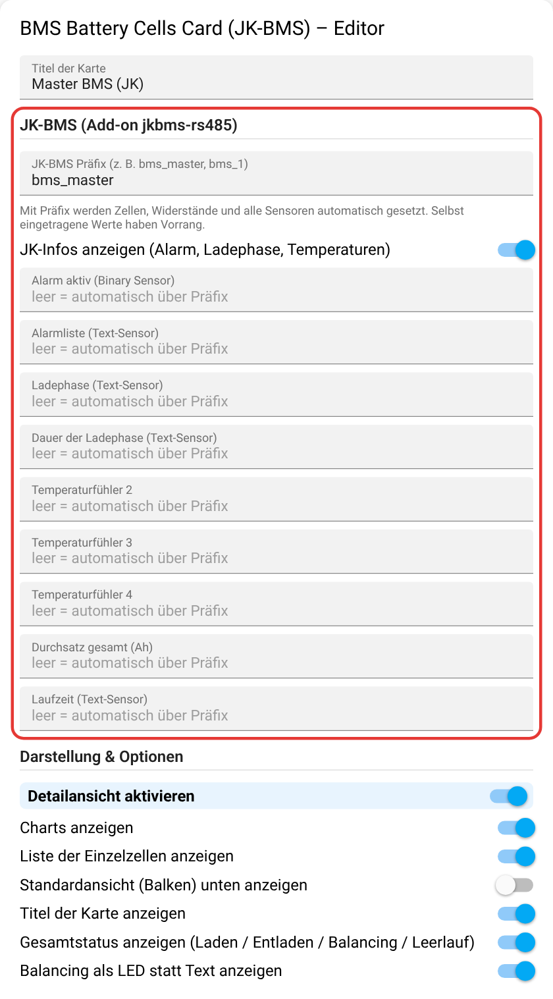
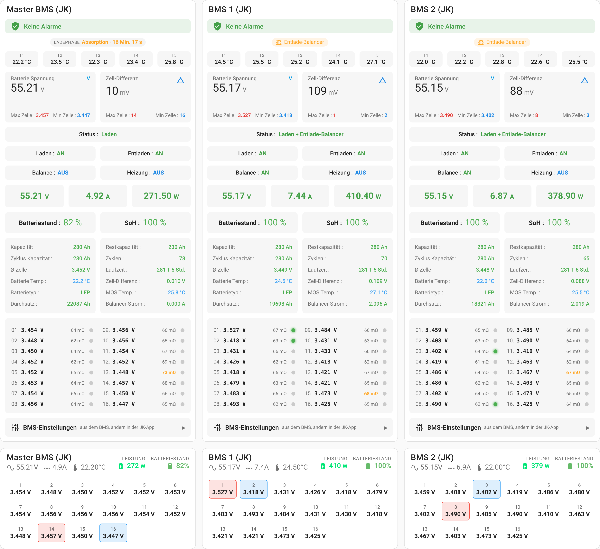
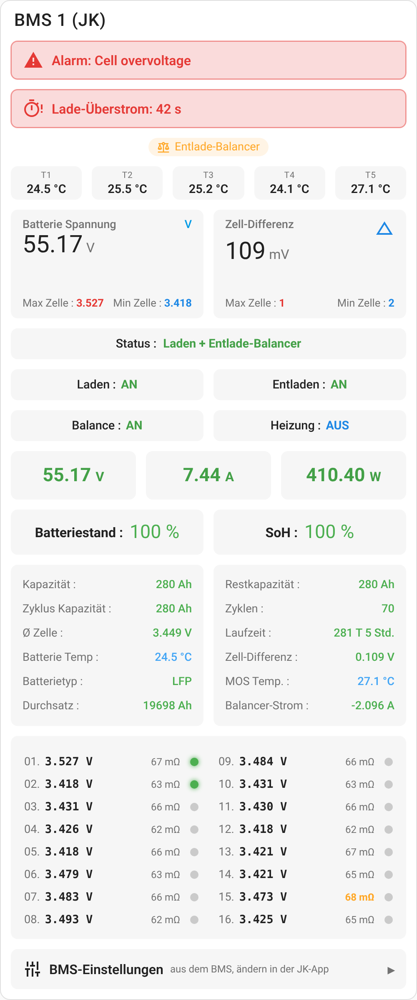
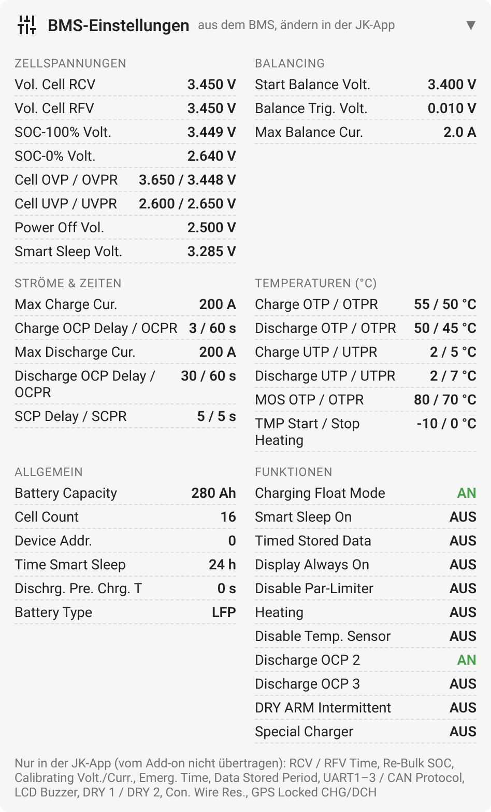
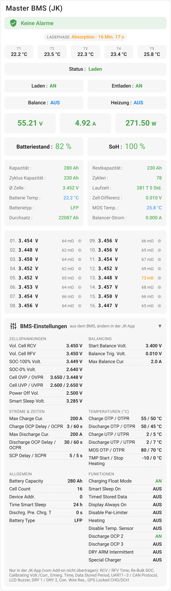
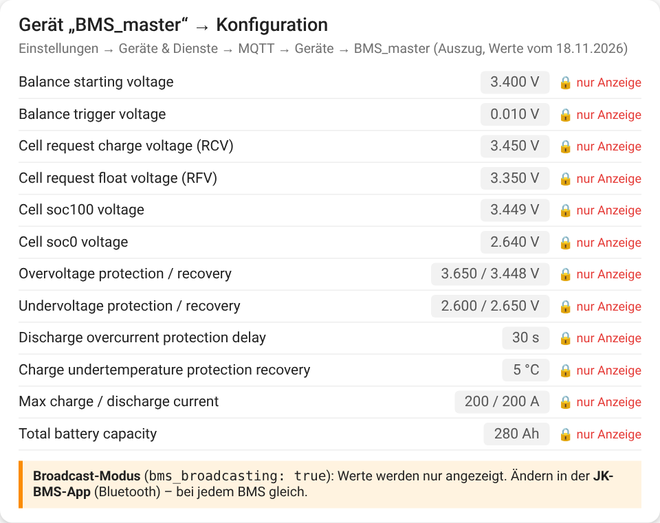

# Einrichten & Werte einstellen

Anleitung für die **BMS Battery Cells Card (JK-BMS)** mit dem Add-on [jkbms-rs485-addon (Fork Xander2980)](https://github.com/Xander2980/jkbms-rs485-addon) (ab 4.2; läuft auch mit dem Original von jean-luc1203).

- [1. Installieren](#1-installieren)
- [2. Karte zum Dashboard hinzufügen](#2-karte-zum-dashboard-hinzufügen)
- [3. Karte einstellen (Editor)](#3-karte-einstellen-editor)
- [4. Passende Darstellungen](#4-passende-darstellungen)
- [5. BMS-Werte einstellen](#5-bms-werte-einstellen)

---

## 1. Installieren

[](https://my.home-assistant.io/redirect/hacs_repository/?owner=Xander2980&repository=bms-battery-cells-card-jkbms&category=plugin)

Oder von Hand: **HACS** → ⋮ (oben rechts) → **Benutzerdefinierte Repositories** → `https://github.com/Xander2980/bms-battery-cells-card-jkbms`, Typ **Dashboard** → Hinzufügen → „BMS Battery Cells Card (JK-BMS)“ herunterladen → Browser mit **Strg+F5** neu laden.

> ⚠️ Nicht unter *Einstellungen → Apps → Repositories* eintragen – dort kommt „is not a valid app repository“.

## 2. Karte zum Dashboard hinzufügen

1. Dashboard öffnen → oben rechts **✏️ Bearbeiten**.
2. **+ Karte hinzufügen** → im Suchfeld `JK-BMS` eingeben → **BMS Battery Cells Card (JK-BMS)**.
3. Im Editor das **Präfix** eintragen (siehe unten) → **Speichern**.

Oder als YAML (⋮ → *Im Code-Editor anzeigen*):

```yaml
type: custom:bms-battery-cells-card-jkbms
title: Master BMS (JK)
jk_prefix: bms_master
show_detailed_view: true
show_status: true
balance_led: true
```

### Welches Präfix?

Einstellungen → Geräte & Dienste → **MQTT** → Geräte → z. B. **BMS_master** → einen Sensor öffnen → ⚙️ → Entitäts-ID ansehen, z. B. `sensor.bms_master_bms_soc_pourcentage`.
Das Präfix ist der Teil **vor `_bms_`**: `bms_master`. Bei mehreren Packs heißen sie meist `bms_master`, `bms_1`, `bms_2` …

## 3. Karte einstellen (Editor)



Rot markiert: der JK-BMS-Bereich.

| Feld | Was eintragen |
|---|---|
| **JK-BMS Präfix** | z. B. `bms_master`. Danach sucht die Karte Zellen (Anzahl automatisch), Zellwiderstände, SoC, Leistung, Spannung, Strom, Temperaturfühler 1–4, MOS-Temperatur, Alarm, Ladephase, Kapazität, Zyklen, Durchsatz und Laufzeit selbst. |
| Felder darunter | **leer lassen** = automatisch. Nur ausfüllen, wenn ein anderer Sensor angezeigt werden soll (z. B. Batterie-Temp = MOS-Temperatur). Eigene Einträge haben immer Vorrang. |
| **JK-Infos anzeigen** | Alarmzeile, Ladephase und T1–T4 ein-/ausblenden. |
| **Detailansicht aktivieren** | großes BMS-Dashboard (Charts, Status, Zellliste mit Widerständen). Aus = kompakte Ansicht. |
| Laden / Entladen / Balance | mit Präfix **nur Anzeige** (`binary_sensor`). Wer per Klick schalten will, trägt hier selbst einen `switch.…` ein – Vorsicht, das schaltet das BMS wirklich. |

## 4. Passende Darstellungen



**Detailansicht** (oben je Spalte):

```yaml
type: custom:bms-battery-cells-card-jkbms
title: BMS 1 (JK)
jk_prefix: bms_1
show_detailed_view: true
show_status: true
balance_led: true
```

**Kompakte Zelltabelle** (unten je Spalte):

```yaml
type: custom:bms-battery-cells-card-jkbms
title: BMS 1 (JK)
jk_prefix: bms_1
temp_entity: sensor.bms_1_bms_mos_temp
show_as_table: true
hide_bars: true
horizontal_layout: true
show_values_on_top: true
show_voltage_diff: true
show_average: true
enable_animations: false
```

**Alarm:** Meldet ein BMS einen Alarm, wird die Zeile oben rot und zeigt den Text; in der kompakten Ansicht erscheint ein rotes Symbol.



## 5. BMS-Werte einstellen

Die Karte **zeigt** BMS-Werte nur an. Die Schutz- und Ladeeinstellungen (OVP, UVP, Balancing, Ladespannung …) liegen im BMS selbst.

### Auf der Karte ansehen

In der **Detailansicht** gibt es unten den Bereich **„BMS-Einstellungen“** (zum Aufklappen antippen). Er zeigt alle Einstellwerte mit den Namen aus der JK-App – so sieht man nach einer Änderung in der App sofort, ob der Wert im BMS angekommen ist. Mit `jk_settings_open: true` ist er gleich aufgeklappt, mit `show_jk_settings: false` ausgeblendet.

Aufgeklappt sieht der Bereich so aus:



Im **Active-Polling-Modus** des Add-ons kommen zusätzlich RCV Time, RFV Time sowie LCD-Buzzer- und DRY-Werte dazu; im Broadcast-Modus stehen sie in der Hinweiszeile „Nur in der JK-App“. Aufbau der `.jkcfg`-Exportdatei: [JKCFG-FORMAT.md](JKCFG-FORMAT.md).

Ganze Detailkarte mit aufgeklapptem Bereich:



### In Home Assistant ansehen

Das Add-on legt pro BMS rund 33 Einstellwerte an: Einstellungen → Geräte & Dienste → **MQTT** → Geräte → **BMS_master** → Bereich **Konfiguration** (Entitäten `number.<präfix>_bms_…`).



**Ob man sie dort ändern kann, hängt vom Add-on-Modus ab:**

| Add-on-Option | Betrieb | Werte in HA |
|---|---|---|
| `bms_broadcasting: true` | Add-on hört am Bus mit (typisch bei mehreren Packs, Master-BMS fragt die anderen ab) | **nur Anzeige** – Ändern in der JK-App |
| `bms_broadcasting: false` | Add-on fragt die BMS selbst ab (Active Polling) | laut Add-on-Doku änderbar, „wenn unterstützt“ |

### In der JK-BMS-App ändern (Bluetooth)

1. JK-BMS-App öffnen, mit dem BMS verbinden (Gerätepasswort nötig – Werkswert `1234` ändern!).
2. **Einstellungen / Settings** → Wert ändern → bestätigen.
3. **Bei jedem BMS gleich einstellen** (Master, BMS 1, BMS 2 …), sonst laufen SoC und Balancing auseinander.
4. Zur Kontrolle pro BMS die Einstellungen als `.jkcfg` exportieren und vergleichen – oder in HA unter *Konfiguration* nachsehen, ob die neuen Werte angekommen sind.

### Beispiel: LiFePO4 16S mit Victron (DVCC 55,2 V)

So ist die Anlage eingestellt, für die diese Karte gebaut wurde – **kein allgemeiner Richtwert**, immer zum eigenen Wechselrichter und Zelldatenblatt passend wählen:

| Einstellung (App) | Wert | Hinweis |
|---|---|---|
| Cell Request Charge Volt. (RCV) | 3,450 V | × 16 = 55,2 V, muss zur Ladespannung des Wechselrichters passen |
| Cell Request Float Volt. (RFV) | 3,350 V | × 16 = 53,6 V |
| SOC 100 % Volt. | 3,449 V | knapp unter RCV, damit SoC bei Vollladung auf 100 % kalibriert |
| Start Balance Volt. | 3,400 V | Balancing läuft während der Absorption |
| Balance Trig. Volt. | 0,010 V | ab 10 mV Zelldifferenz |
| OVP / OVPR | 3,650 / 3,448 V | |
| UVP / UVPR | 2,600 / 2,650 V | Wechselrichter schaltet vorher ab (z. B. 46,0 V) |
| Discharge OCP Delay | 30 s | |
| Charge UTP / UTPR | 2 / 5 °C | |
